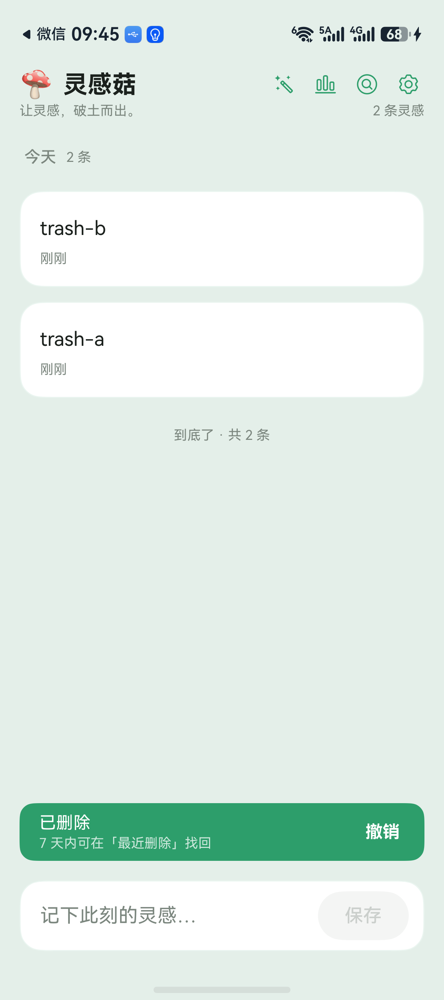
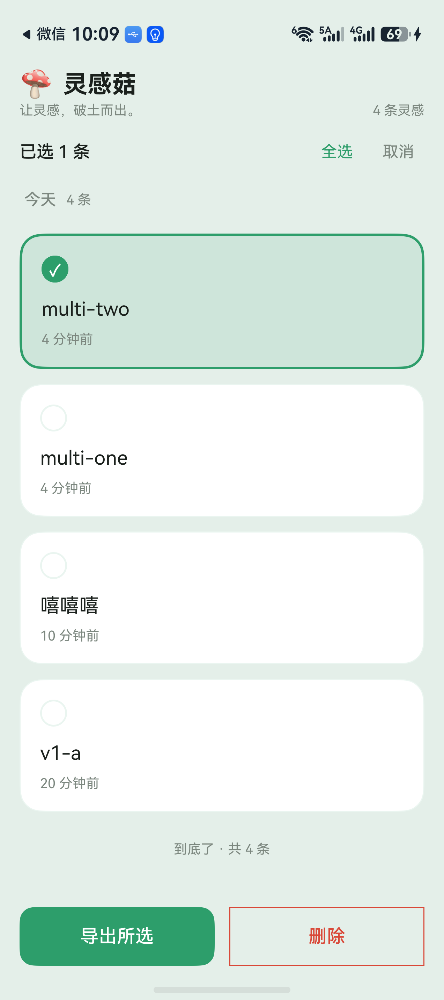
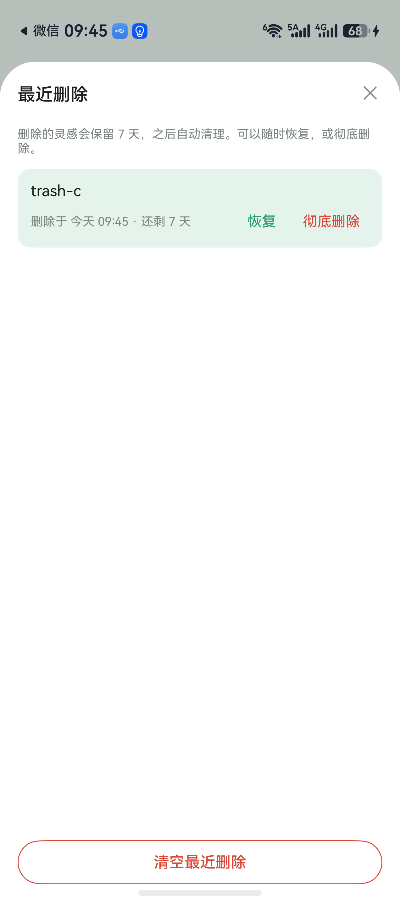
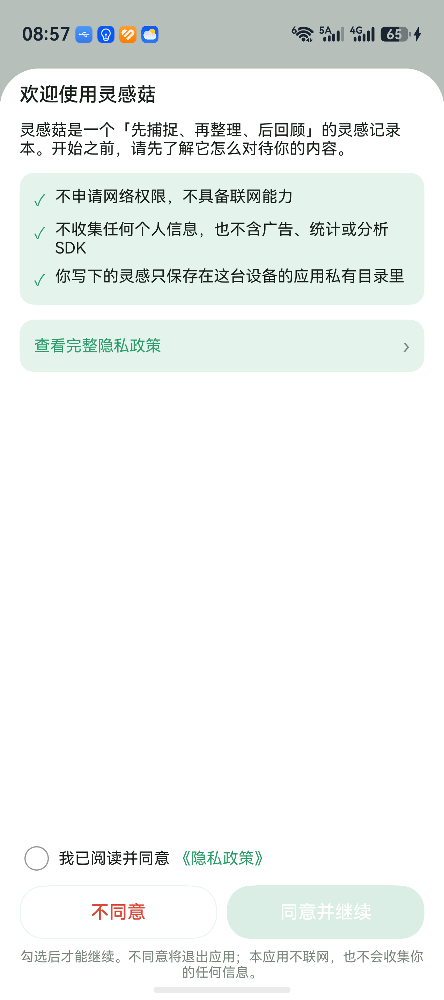

# 灵感菇 · Musehroom

> 三秒记下灵感的本地优先 HarmonyOS 笔记应用。
> 不联网、不登录、不收集任何信息 —— 你写下的东西只留在这台设备上。

灵感菇是一个「先捕捉、再整理、后回顾」的灵感记录本：打开即写，写完就走；之后按天回看、打标签、筛主题，也可以在需要时把全部内容导出成 JSON / Markdown。

| 时间轴 | 多选整理 |
| --- | --- |
|  |  |
| **最近删除（7 天）** | **首启隐私明示同意** |
|  |  |

## 特性

- **快**：底部输入框常驻，写完点保存；新灵感落在当天时间轴顶部。
- **链接识别**：正文里的 URL 自动变成可点的链接，点开交给系统浏览器。
- **标签**：`#标签` 自动解析、去重、按天聚合；标签云支持折叠与筛选。
- **回顾**：按天分组、置顶、搜索、按标签 / 按天筛选；「记录足迹」用热力图看坚持。
- **最近删除**：删除先进「最近删除」，保留 7 天，可恢复；彻底删除 / 清空才弹确认。
- **多选整理**：长按任意卡片进入多选，批量删除或批量导出（JSON / Markdown）。
- **数据自由**：JSON 完整备份（含标签与原始时间，可再导回来）、Markdown 给人读；导入是合并式的，已删除的会恢复。
- **隐私**：无网络权限、无账号、无广告 / 统计 SDK；首启有空白复选框 + 同意 / 不同意，不同意直接退出。
- **观感**：深浅色跟随系统、5 套主题色、系统符号图标。

## 隐私

- 唯一权限：`ohos.permission.VIBRATE`（保存 / 删除的轻震动）。
- 不申请网络权限，App 自身不具备联网能力。
- 隐私政策正文见 [legal/index.html](legal/index.html) 与 [docs/PRIVACY_POLICY.md](docs/PRIVACY_POLICY.md)，线上地址：<https://lobing11.github.io/musehroom-legal/>。

## 构建与运行

环境：**DevEco Studio 6.x** + **HarmonyOS SDK 6.1.1 (API 24)**，Stage 模型，ArkTS。

1. 用 DevEco Studio 打开本仓库。
2. 首次构建前配置本地签名（签名材料不入库）：
   `File → Project Structure → Signing Configs → 勾选 Automatically generate signature`。
   DevEco 会在 `build-profile.json5` 里写入本机 `signingConfigs`，**这份 diff 不要提交**。
3. 连接 HarmonyOS 真机或模拟器，点 Run。
4. 命令行构建（未配置签名也能编过，只是产物未签名）：

   ```bash
   hvigorw assembleHap --no-daemon
   ```

   未配置签名时会看到 `WARN: No signingConfig found for product default`，属于预期；要装到设备上仍需先做第 2 步。产物在 `entry/build/default/outputs/default/`。

> App 以 `com.lobing.musehroom` 为包名；自行分发时请改成你自己的 bundleName。

## 单测

本地单测在 `entry/src/test/`，只测纯逻辑（不碰数据库 / ArkUI）：

- 用 DevEco Studio 打开 [entry/src/test/List.test.ets](entry/src/test/List.test.ets)，点 `testsuite()` 左侧的 ▶ 运行，结果在 Run 面板。
- 当前 SDK 的 hvigor 没有 `test` 任务，命令行跑不了本地单测。
- 新增测试文件后要在 `List.test.ets` 里 `import` 并调用，否则不会被收集。

## 目录结构

```
AppScope/                 应用级配置（bundleName、版本号、图标）
entry/src/main/ets/
  pages/Index.ets         唯一的页面：时间轴 + 设置 / 详情 / 回收站 / 隐私半模态
  views/                  卡片、输入条、标签云、统计、隐私与回收站面板
  viewmodels/             时间轴状态（分页、筛选、软删除、撤销）
  service/                导出 / 导入（JSON、Markdown）
  repository/ database/   RDB 访问层（v1 → v2 迁移：deleted_at）
  utils/                  标签 / 链接解析、日期、保留期、UTF-8 字节数
entry/src/test/           本地单测
docs/                     隐私政策、截图
legal/                    应用市场用的隐私政策静态页
tools/                    发版打包脚本
```

## 版本

当前 **1.2.0**（versionCode 1002000）。变更见 [CHANGELOG.md](CHANGELOG.md)。

## 参与

见 [CONTRIBUTING.md](CONTRIBUTING.md)。提交前请确认没有把签名材料、本机路径或设备信息带进仓库。

## 许可证

[MIT](LICENSE) © 2026 lobing
